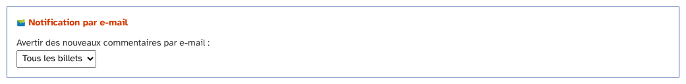

# Email notification : guide d'utilisation

Email notification vous envoie un e-mail à chaque nouveau commentaire laissé sur le blog. Chaque utilisateur choisit s'il veut être prévenu et pour quels billets.

Ce plugin n'a pas de page d'administration : le réglage se fait dans les préférences de chaque utilisateur.

## Sommaire

1. [Ce qu'il faut avant de commencer](#ce-quil-faut-avant-de-commencer)
2. [Régler sa notification](#régler-sa-notification)
3. [Régler la notification d'un autre utilisateur](#régler-la-notification-dun-autre-utilisateur)
4. [Qui reçoit quoi](#qui-reçoit-quoi)
5. [Le contenu de l'e-mail](#le-contenu-de-le-mail)
6. [Bon à savoir](#bon-à-savoir)

## Ce qu'il faut avant de commencer

* Le serveur doit pouvoir envoyer des e-mails (le plugin utilise la fonction d'envoi de Dotclear). Le plugin **testMail** permet de le vérifier.
* L'utilisateur doit avoir une **adresse e-mail** dans son profil. Sans adresse, il ne reçoit rien.

## Régler sa notification

1. Ouvrez **Mes préférences**, puis l'onglet **Mes options**.
2. Dans le bloc **Notification par e-mail**, choisissez dans la liste **Avertir des nouveaux commentaires par e-mail** :
   * **Jamais** : aucun e-mail (réglage par défaut) ;
   * **Mes billets** : seulement les commentaires sur les billets dont vous êtes l'auteur ;
   * **Tous les billets** : les commentaires sur tous les billets du blog.
3. Enregistrez.



## Régler la notification d'un autre utilisateur

Un administrateur peut régler la notification de chaque utilisateur dans **Système > Utilisateurs**, en modifiant la fiche de l'utilisateur. La même liste y est proposée. Elle est aussi proposée à la création d'un utilisateur.

## Qui reçoit quoi

Un e-mail est envoyé pour chaque nouveau commentaire laissé depuis le site public, sauf pour ceux qui sont classés comme indésirables (spam). Les commentaires en attente de modération sont notifiés : l'e-mail indique leur statut.

Peuvent être prévenus :

* les utilisateurs qui ont une permission sur le blog ;
* les super-administrateurs, même sans permission sur ce blog.

Pour chacun, le choix **Mes billets** ou **Tous les billets** décide s'il est prévenu. Avec **Mes billets**, l'e-mail est envoyé à l'auteur du billet commenté.

## Le contenu de l'e-mail

L'objet est de la forme `[Nom du blog] "Titre du billet" - Nouveau commentaire`. Le message reprend le commentaire, puis un bloc d'informations :

```
Vous avez reçu un nouveau commentaire sur votre blog :

Superbe article, merci pour les conseils !

-- 
Blog : Mon blog
Billet : Les champignons de l'automne <adresse du billet>
Commentaire par : Marc Petit <marc@example.org>
Site web : 
Statut du commentaire : Published
Modifier ce commentaire : <adresse de modification dans l'administration>
Vous devez vous enregistrer sur l'interface d'administration avant de cliquer sur ce lien pour aller directement sur ce commentaire.
```

Le lien **Modifier ce commentaire** ouvre le commentaire dans l'administration ; il faut y être connecté. Quand vous répondez à l'e-mail, la réponse part vers l'adresse du commentateur (champ « Reply-To »).

## Bon à savoir

* **Le statut n'est pas traduit** : la ligne « Statut du commentaire » affiche le mot anglais (`Published`, `Unpublished`…), même sur un blog en français.
* **Pas de réglage par blog** : la notification est un réglage de l'utilisateur, il est le même sur tous ses blogs.
* **Un seul e-mail par destinataire** pour chaque commentaire, envoyé immédiatement, sans regroupement.
* **Les rétroliens** sont aussi des commentaires : ils sont notifiés comme les autres.
